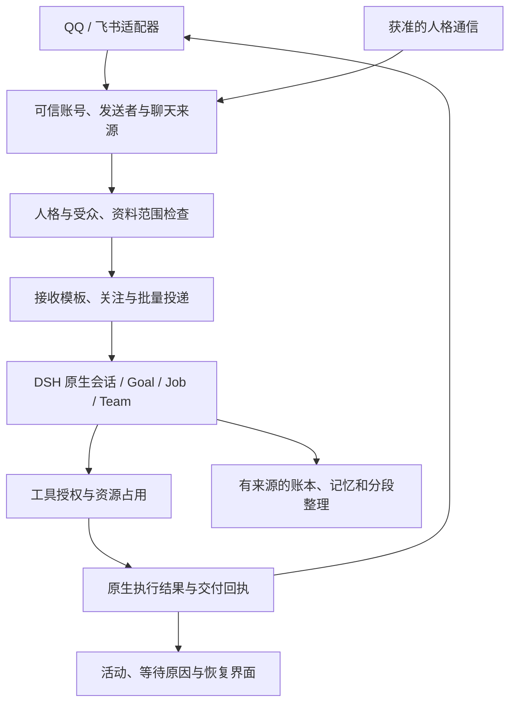

# 持续人格的跨渠道与活动协调

状态：第二阶段协作补强及第三阶段实施规划，未发布。基于已完成实现和隔离验收的第一、二阶段，继续使用 DSH 的执行、权限、会话、Goal、Job、Team 和存储。

## 1. 目标与职责

人格持续拥有身份、经历与行为规则；会话承载交流或工作；原生任务机制拥有执行状态。渠道提供接收和交付能力，不能另造一套人格或执行器。

本阶段完成通用接收模式、有受众边界的人格通信、可调整的并行活动及资源协调。第二阶段只补强这些流程所需的来源、记忆和压缩衔接，不重建记忆引擎。

| 所有者             | 权威状态                           | 本阶段适配                     |
| ------------------ | ---------------------------------- | ------------------------------ |
| DSH 会话与执行     | 输入队列、原始事件、工具权限、取消 | 输入来源、请求编号、投递与等待 |
| 原生 Goal/Job/Team | 目标、后台工作、成员和任务终态     | 活动关联、回执订阅、交互呈现   |
| PX 人格与知识      | 固定身份、场景、资料范围和资源约束 | 通信来源及明确分享范围         |
| 渠道适配器         | 登录凭据、账号连接、消息和发送结果 | 共同接收决策及平台能力标记     |
| 电脑和浏览器工具   | 实例、动作、窗口授权和停止释放     | 可查询占用者、可取消等待       |
| 前端               | 用户设置、审批、进度与恢复         | 统一收件、关注、通信和活动视图 |

## 2. 已确认基础与待核查接口

QQ 已有三种消息模式、按人格临时关注、单连接路由与去重回执；投递器最多同时推进四个不同聊天，执行仍归原生 Agent。用户明确设置覆盖临时变更。

通用 SessionChannel 已按 provider/account/conversation 区分来源，不能凭聊天名称或正文自称判断身份。浏览器已有会话独立实例；携带登录状态的共享实例同时只服务一个会话。后台窗口支持情况与前台授权仍分别判断。

飞书保留社区 IM 原包的账号和配置入口；需要验证消息投递前、发送后及会话创建处的实际扩展点。人格通信也需要核对原生输入来源与创建接口；不能假定存在未验证的公共接口，或用普通用户文本伪装人格授权。

### 飞书原包的已核查接入契约

锁定的 IM 5.6.0 已提供同 Host 的 dshIm 服务：describeBot 校验账号，consumeInbound 独占文本收件，replyChecked 校验原消息回复路由，historyChecked 读取有界群或话题文本。账号 fingerprint 必须匹配；这些能力只表示接口可用，不表示用户已授权任务。

接收回调必须先检查受众、去重并完成持久提交，再返回 accepted。实时和历史消息以平台 messageId 去重，键包含平台、Bot、认证账号指纹与聊天；显示名不用于身份判断。群/私聊类型和提及来自原包的可信事件，正文不用于决定权限。

收件凭据与执行状态分开：原生会话确认接收后移除收件层的重复正文，只保留来源、精确回复路由、原生消息编号及去重凭据。投递中断标为结果待核对，不自动重放；打开数据库本身不改变在途状态，取得独占接收权后才进行恢复核对。收件时须固定目标人格和路由修订，重投不重新分配；路由切换要处理待收件与在途工作，不能把旧输入悄悄交给新人格。

consumeInbound 会持久将账号切为 external-consumer，重启连接；此时原包的独立会话、slash 与卡片回调停止处理。释放接收方后不会自动恢复独立处理，避免双答。日常账号切换必须有明确界面、状态与返回原模式的路径；在这些路径完成验收前不自动接管现有账号。

当前独占接口只保证文本及有界文本历史，不提供头像、附件或全部平台业务能力。统一接收适配还须验证命令、原生审批反馈和不支持消息的呈现；不能把社区独立模式已有的媒体/卡片能力默认为独占模式也具备。原始包、编译导出与实现文件已核对，隔离租约实验不等于真实飞书收发验收。

#### 飞书模式恢复适配（已确认，实施中）

原包没有与 consumeInbound 对称的公开模式恢复方法。隔离控制器测试确认：连接启动失败、释放消费者和重启均保留 external-consumer；关闭控制器后通过原生配置存储恢复 standalone 可行。产品不能依靠用户手动编辑这个隐藏字段恢复。

建议仅对 Pack 受管的固定原包增加可审查兼容补丁，保留来源、许可证、原始归档与摘要，并标注派生版本；用户独立安装的原包不覆盖。补丁不增加第二个飞书 SDK 连接或任务执行器，范围如下：

- 描述接口返回真实 consumerMode、接收租约状态与模式修订；连接状态与接管状态分别显示。
- 增加同 Host 的显式恢复方法，检查账号 fingerprint、预期修订与现有租约；有活动消费者时拒绝恢复，不隐式抢占。通过原生每账号变更队列停止连接、保存模式、重新连接。
- 接管或恢复失败时显示当前持久模式及连接错误，不自动降级为另一处理方。恢复到独立模式前，协调器必须停止接收、结算在途收件与发送，并释放自己的租约。
- 原生管理界面提供返回独立处理的入口，使 PX 停用后也能恢复；不需要清空账号、重建机器人或重新输入凭据。
- PX 接管页明确只接入已验证的文本能力；保留原生执行权限。斜杠命令和审批反馈必须经真实收发验收后才开放对应任务，不把社区原有卡片能力列为已继承功能。

验收需要覆盖身份不符、过期修订、活动租约、连接失败、停用 PX、宿主重启以及两次模式往返；检查其他账号及第三方配置保持。兼容补丁和日常账号切换分别验证，未经确认不修改日常机器人模式。

## 3. 通用接收模式

| 模板   | 内容                                         | 唤醒与回复                               |
| ------ | -------------------------------------------- | ---------------------------------------- |
| 专注   | 获准范围内完整消息，按聊天分批               | 模型可回复、发表情或静默，不要求每条都答 |
| 普通   | 私聊、提及和关注聊天完整；其他计数与有界预览 | 依用户提醒设置处理                       |
| 仅通知 | 获准通知的来源、计数和预览                   | 决定查看后再打开相应聊天取详情           |

配置按人格和账号生效。群/私聊性质来自可信适配器元数据，聊天标识按平台保持不透明；同名或同编号的不同平台、账号必须隔离。

接收策略只决定内容量和唤醒，不授予执行、资料或发送权限。自身消息、重复投递和模式切换不能重放已执行任务。临时关注有期限并服从用户设置；不支持的平台能力明确显示。

先提取纯决策层并保持 QQ 行为，再适配飞书。定义通用类型不等于真实渠道已经可用。

### 原生运行适配边界

工作台通过同 Host 的 `pxChannels` 连接渠道与原生 Agent；账号设置由原生 `configEditor` 保存到独立的 `dsh-px-channel-settings` 配置项，默认没有启用账号。该配置项仍随基础包交付，更新它不会重载工作台的文件、上下文策略和其他服务。消息模式变化直接作用于已有接收方；账号变更分别结算，一项慢停止不阻塞其他账号。凭据仍归 IM 原包。保存采用整行修订检查，保留其他配置；人格、账号身份、工作区或公共说明变化时生成新的路由修订，旧收件保持原目标。

飞书公共交流使用原生 `px-channel-public` 预设，创建和恢复均先固定人格及受众。模型选择复用原生待选配置和请求头，恢复会话不改全局默认模型。聊天执行目录分别隔离，并按原生规则挂入执行目录对应的工作区；已有工作区归属保留。

公共预设只开放当前聊天的回复、受校验的文本历史、交流记忆、共享知识和人格历史工具。界面恢复会话也须经过同一预设与工具 guard。原生后置注入的私有记忆和项目指令不会绕过公共边界。配置授权成员不直接授予任务执行权；飞书任务入口须在授权、审批与交付链路完成后另行开放。

原生输入队列、执行与完成状态归 DSH；PX 收件箱保存投递归属和回执。投递前保存原生消息 ID 与日志起点，重启后通过原生只读句柄分批查证，并完成原生持久检查后补齐确认；不创建 Agent 或重新提交输入。没有找到依据不代表任务未执行，仍保持待核对。

回复先保存意图与待发正文，按来源消息和原生工具调用事件识别；明确成功才记录发送成功，结算后清除重复正文。结果未知时暂停同一聊天的继续发送，不自动重试。“渠道与活动”页面提供人工确认已发送及允许后续新回复，两者均标明人工依据，不冒充平台回执；核对采用版本检查，发送尚未结算时不能抢先修改。停止接收后先结算投递、工具调用及所持原生会话，再释放接收租约，避免与恢复后的原生 IM 同时处理。

公共交流链路的受控测试与真实模型、真实平台及安装后验收分别记账。通知预览进入收件状态，不等于已完成跨活动的注意力调度；完整接续、人格通信与活动协调仍按后续步骤验收，不能由单条收发成功代替。

## 4. 人格通信

信封记录发件人格、接收人格、来源会话、用途、受众和稳定编号。默认不附带私有会话、记忆或 Skill 正文；共享资料沿用既有版本引用与有界交接。

发出与接收分别校验许可，入队和实际读取时复核。消息是资料，不携带发送方或用户的权限；不能借用高权限人格绕过工具规则。接收会话仍由原生创建，先固定人格再接收首条输入。

通信记录只关联原生输入和回执，不维护第二份任务终态。原生 Team 临时成员不是另一个长期人格。自动回复继承本次通信范围与期限，设置轮次、跳数和并发预算；没有新输入、未完成工作或授权触发时，不靠空转对话冒充持续性。

默认采用显式允许的通信关系与共享内容。默认主动互聊、自动公开私有资料或更宽的任务委派权限需要具体方案和单独确认。

### 通信入口与原生执行

“设置 → 渠道与活动 → 人格通信”按发件人格、收件人格与来源场合保存单向关系，可设置截止时间。关系默认空；本机私人会话、本人渠道私聊和每个公共聊天分别匹配。原生配置保存采用修订检查，刷新不覆盖未保存草稿；人格的资源规则仍可进一步限制通信。

`persona_mail` 只传递调用者明确提供的正文。发送立即返回原生 Job 编号，来源会话可继续工作，并用原生作业工具收取、取消，或按通信编号查询回复。接收端是独立原生 root，不继承发件方的会话历史或预设。接收者可用原生历史读取找回同一对人格、同一来源受众与项目中的交流，并通过现有 Mnemon 文档引擎保存有来源的交流记忆，或读取明确共享的知识；不开放本机操作和继续转发。私人会话、私有记忆、Skill 和项目指令不自动进入接收请求。每封来信仍只接受一次有界回复，原始人格来信及回复标为交流建议，不作为用户授权或独立的人类正反馈。

通信日志记录来源会话与事件位置、独立接收会话、原生 Job、消息回执和回复，不能代替原生任务终态。每次请求固定授权版本；撤销、过期或人格停用会停止尚在运行的接收会话。原生接收会话释放后才结算 Job；未能释放时阻止新通信并显示错误。重启不会重放在途来信，缺乏结算依据的投递显示待核对。已有回复保留为交流证据，不宣称来源 Goal 已完成。

后续验收仍须覆盖渠道中的真实调用、多活动上下文、指定资料共享、通信恢复、Electron 和真实消息平台。基础通信及页面通过受控实验不代表全部第三阶段完成。

## 5. 活动与资源协调

活动关联原生会话、Goal、Job、Team 和来源渠道。区分已收件、入队、执行、等待、交付中与终态，完成和交付以真实回执为准。

慢工具或成员运行时继续推进独立活动；先给可核验中间结果，再根据新输入调整计划。聚合重复通知，避免每条观察都触发模型。

隔离浏览器可并行；共享登录浏览器、前台键鼠和同一聊天交付流报告占用者，等待可取消，不悄悄抢占。不为独立资源增加全局串行锁。

占用记录限定人格、会话、活动、具体资源及期限。取消、停用和异常释放资源；旧回执不能解除新占用。恢复只重建可证明状态，不自动重发结果未知的副作用操作。

浏览器实现保留连接所有者与唯一代次，关闭全过程仍占用共享连接；旧启动失败回调和旧释放请求不影响新连接。停止须核对 MCP 服务进程退出，释放失败保留状态供明确重试；并行关闭分别结算，不因一项失败省略其他清理。独立浏览器保持会话隔离并行。资源等待由 `px-resource-wait` 原生 Job 提供有界通知，来源会话可以继续独立步骤；通知只报告观察到的可用性，不抢占或保留资源。桌面驱动保留原有串行投递，增加调用归属和可立即取消的排队等待。完整的跨活动资源协调、真实桌面输入和恢复仍须分别验收。

## 6. 第二阶段协作补强

- 来源在压缩后可追溯，历史内容不提升为新授权。
- 账本关联当前原生活动，不将注意力状态当作工作完成。
- 重复转述不算多份独立正反馈；记忆候选保留人格、受众及原始事件。
- 历史与分段整理保留人格来信、建议及协调回执的类别。作业查询本身不证明应用成功；原生命令的输出需核对同一所有者的登记、生产者终态和原始事件，重复读取同一 Job 只计一次反馈来源。索引格式更新只重建派生缓存，原始事件摘要与记忆来源引用保持稳定。
- 分享被纠正或撤销后，迟到总结不能恢复旧内容。
- 公共本机操作经验可沉淀为公共 Skill，个人偏好仍私有；技能与执行权限分开。

## 7. 实施顺序

| 步骤 | 交付                         | 通过条件                                  |
| ---- | ---------------------------- | ----------------------------------------- |
| S2.1 | 来源、账本与活动边界清单     | 原生复用点及缺口有源码或运行证据          |
| S3.1 | 通用接收决策、QQ 和飞书适配  | QQ 既有行为保持；真实双渠道、账号隔离通过 |
| S3.2 | 通信关系、信封与原生接收回执 | 身份不可由正文伪造，权限和资料不扩散      |
| S3.3 | 活动关联、并发等待与资源占用 | 实际并行、共享互斥、取消可释放            |
| S2.2 | 跨活动记忆与重复压缩补强     | 晚到消息、纠正与恢复不污染结论            |
| S3.4 | 双端交互和综合验收           | 真实模型/渠道、故障、审查和质量门禁结算   |

新增宿主接口、不可逆迁移、改变默认账号或权限语义前，先提交具体方案及原生复用不足的证据。例行实现、可逆界面和隔离测试持续推进。本目标不自动包含发布或日常升级。

## 8. 验收矩阵

| 编号 | 场景                                    | 必须达到的结果                                  |
| ---- | --------------------------------------- | ----------------------------------------------- |
| A01  | QQ/飞书三模式、私聊/群/提及/免打扰      | 内容、预览、唤醒和静默符合配置                  |
| A02  | 双账号重名聊天、双人格关注、用户覆盖    | 不串收件、设置或临时关注                        |
| A03  | 通知后打开聊天、风暴及重复事件          | 可取详情、批量有界、不重做或自激                |
| P01  | 人格交换消息和指定资料                  | 来源可靠，仅共享获准资料                        |
| P02  | 冒充、转发注入、借高权限人格办事        | 不升级权限，不泄露私有内容                      |
| P03  | 通信中取消、撤销、离线和重启            | 不重复发送/执行，未知交付明确显示               |
| T01  | 两项独立任务与慢工具/成员               | 有真实重叠，其他工作与中间交付继续              |
| T02  | 插话、目标改变、迟到回执                | 新要求优先，旧结果不冒充当前完成                |
| R01  | 独立实例并发与共享资源争用              | 独立并行，共享不抢占且可解释                    |
| R02  | 超时、异常、取消、旧令牌释放            | 可恢复，旧活动不能释放新占用                    |
| M01  | 多次压缩、纠正、重启与重复引用          | 来源可找回，不刷权重、不复活旧资料              |
| U01  | Web/Electron 配置、错误、恢复和活动视图 | 真实后端状态，草稿与用户设置保留                |
| Q01  | 精确提交与候选                          | 必需检查、独立审查、原生安装/恢复及真实验收通过 |

模拟网关、控制模型与真实渠道分别记录。验收数据、截图、个人机器路径和凭据只保存在忽略目录；公共文档记录使用、合约与维护边界。
