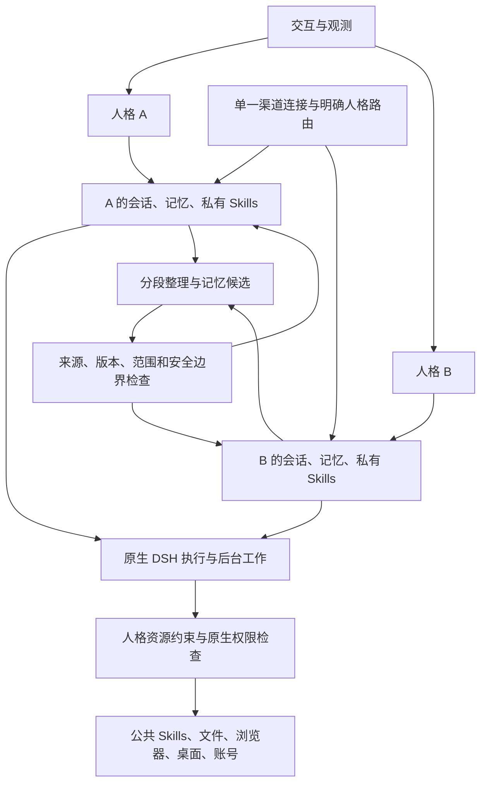
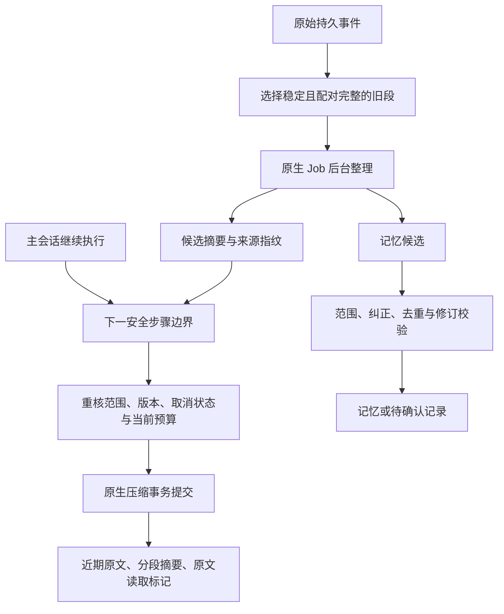

# 持续人格主体改造规划

状态：已确认的目标设计，第一、二阶段实施中。本文定义目标、接口和验收，不代表下列能力已经发布。现有发行能力仍以 [当前状态](../STATUS.md) 为准；当前优先工作入口为 [路线图](../ROADMAP.md)。

## 1. 目标与范围

将人格从会话上的表达配置提升为持续主体：人格拥有身份、关系与场景规则、自己的会话、记忆、经历和私有 Skills；工具、环境、公共 Skills 和渠道账号由平台提供，按人格授权和活动分配。继续使用 DSH 的模型、会话、Goal、Job、Team、权限、原始事件和插件生命周期。

本次交付到第一、二阶段的实现与验收。第三阶段的通用渠道扩展、独立人格自主通信和完整活动调度保留接口方向，不计入本次完成条件。正式产品发布、兼容代际和本机日常更新在验收后按实际接口变化决定，不以规划文档或原型通过代替正式发行。

### 必须达到的用户体验

1. 用户能切换当前人格，看到该人格自己的会话和资料。切换视图不重新标记旧会话，不暗中暂停其他人格的工作。
2. 同一人格跨会话可以找回获准的经历和记忆；不同人格不能通过普通记忆、历史或 Skill 接口读取彼此私有内容。
3. 表达按对象、关系和场景调整；资料受众、工具权限独立判断，熟悉程度和语气不授予权限。
4. 通用本机操作方法可以成为公共本地 Skill，个体方法可以成为人格私有 Skill。工具可用性仍由权限决定。
5. 多人格共用 QQ 的一个连接，明确哪个人格负责哪段聊天；不重复消费，不串话，不以切换人格重放旧输入。
6. 记忆有来源、修订和反馈；正确、有用、常用是不同属性。纠正和遗忘不被高权重或迟到后台工作撤销。
7. 较早对话在后台分段整理，主会话可继续推进；在安全边界提交压缩，模型和用户能识别摘要范围并取回原文。
8. 重启、取消、故障和并发修改后，实际状态与界面一致；无依据时不报告完成、已记住或已交付。

## 2. 系统与数据权威

| 系统             | 职责                                                 | 权威状态与边界                                |
| ---------------- | ---------------------------------------------------- | --------------------------------------------- |
| A 人格与认知     | 身份、表达、关系、行为规则、记忆、经历、私有 Skills  | PX 人格版本、资料修订；不拥有原生任务终态     |
| B 会话与上下文   | 当前交流、上下文装配、分档、分段摘要、原文恢复、账本 | DSH 原始事件与上下文投影；摘要不是新授权      |
| C 活动与协作     | 目标、任务、后台工作、Team、后续人格通信             | DSH Goal/Job/Team；本次不另造目标执行器       |
| D 渠道与注意力   | 接入、来源身份、接收模式、聊天路由与交付             | 原始渠道标识、收件与交付记录；不能授权执行    |
| E 能力与资源     | 工具、环境、账号、公共 Skills、硬权限、资源占用      | 原生权限加人格资源约束；可见不等于有权使用    |
| F 交互与观测     | 人格切换、配置、资料管理、审批、轨迹与诊断           | 呈现实际后端状态；前端隐藏不能代替授权检查    |
| G 原生运行与发行 | DSH 宿主、存储、模型调用、插件装配、更新恢复         | 原生宿主和发行清单；不复制会话与 Job 生命周期 |

系统分类不等于新增七个进程或插件包。优先在现有插件中拆出纯合约、业务服务与宿主适配层。共享代码不得让浏览器客户端导入 Node 模块。

## 3. 第一阶段：人格主体与资源归属

### 3.1 稳定身份和会话

- `personaId` 为稳定主体标识，`personaRevision` 为会话采用的配置版本，二者不能由显示名称替代。
- 会话开始后保持所属人格；切换当前人格只改变导航和新会话默认选择。
- 创建新会话、切回既有会话、显式交接资料是三种不同操作。交接必须保留来源与截止点，不复制运行中的 Goal 或默认授予旧人格私有资料读取权。
- Team 子 Agent 继续继承父人格和受众；不同角色不是不同人格。
- 归档人格保留资料和历史，拒绝新活动；切换、归档、删除及后台运行状态分别呈现。

### 3.2 场景表达与资料受众解耦

- 身份保留稳定原则；表达提供可编辑起点。场景规则按渠道、聊天、已核实对象和活动类型匹配。
- 表达规则只影响沟通与协作方式，不修改硬权限，不将记忆推断直接提升为系统规则。
- 人格配置在每轮前取快照；场景、对象和规则版本随请求可核对，不在工具链中途改变身份。
- 建立通用来源/受众合约，逐步替代将 `provider: qq`、`owner/public` 写死在人格存储中的耦合。
- 旧的公开表达与私人要求保持原可见语义；迁移不能将私人要求变成面向所有对象的表达规则。
- 身份链接必须有可信依据，不根据相同昵称把跨平台成员合并。

### 3.3 资源约束与软规则

- 硬权限控制目标、操作、主体、受众与有效期；软规则控制主动性、表达、打扰程度和行为偏好。
- 有效权限为原生会话权限与人格资源约束的交集。人格规则不能扩大宿主权限。
- 能可靠判定的条件由代码执行：真实渠道发送者、资料范围、Skill 所有者、资源路由版本、暂停和撤销。
- 审批沿用原生请求；确认后只授权相应主体、资源、操作与期限，不把普通聊天文字当审批。
- 已授权的普通动作不逐次重复询问；资源占用冲突与缺少权限分别报告。
- 私有目录与普通业务接口隔离，不等于同一 Windows 用户下恶意全权限终端的操作系统隔离。若验收要求覆盖这种对抗场景，须单独确认独立运行环境或权限范围变化。

第一阶段的可配置执行边界采用工具名称白名单与 QQ 账号范围，二者默认沿用现有原生配置。白名单作用于原生最终 guard，覆盖作用域工具与嵌套调用；工具展示过滤只用于减少无效尝试。收紧后的规则约束后续调用，新增授权从下一轮使用，子 Agent 还要满足发起轮的资源范围。原生子任务的结构化结果提交保留，以便受限任务能够正常结束；它不授予外部行动能力。已开始的外部动作需要通过原生停止操作终止，不能承诺撤销已经发生的副作用。

资源规则独立于语气配置版本保存，用户可以从人格目录修改，无需先给模型开启工具。QQ 规则同时检查接入、通知判断、切换和交付，撤销某个人格不关闭其他人格共用的连接。未适配的第三方渠道仍受工具白名单与其原生权限约束，不能把 QQ 的账号检查宣称为所有渠道均已支持。

原生历史工具也必须遵守人格与受众边界。锁定宿主的原始工具以工作区授权，不能直接等同于人格隔离；事件读取、跨会话搜索、标题与谱系均要过滤。过渡保护拒绝未限定的原生跨会话搜索和未适配谱系入口，明确交接使用 PX 的有界历史接口。这不作为完整原生适配的完成依据。拟采用的只读授权钩子由 PX 提供固定的可见会话集合，并在原生异步读取后重新检查授权；是否纳入 Desktop 覆盖层待用户决策。

### 3.4 Skills

| 范围     | 所属             | 默认发现范围           |
| -------- | ---------------- | ---------------------- |
| 人格私有 | 指定人格         | 该人格获准会话         |
| 项目共享 | 项目             | 获准使用此项目的各人格 |
| 本机公共 | 当前 PX 数据环境 | 获准使用的各人格       |

- 复用原生技能发现、加载与文件版本检查；通过会话作用域的 Provider/过滤机制接入人格私有来源。
- 同时保护技能名称、描述、路径、正文、调用入口与编辑 API，不能只在前端过滤。
- 发现时显示实际来源；同名覆盖必须确定且可解释，不让私有技能覆盖安全约束或原生工具。
- 公共本地技能描述本机通用方法与适用版本，不含私聊、凭据、真实账号和验收运行数据。
- 从私有经验发布公共 Skill 是独立采纳动作；去除私人材料并保留证据与适用条件。
- Skill 不是执行权限；读到工具用法不等于获准调用该工具。

### 3.5 单连接 QQ 人格路由

- 账号凭据、连接和收件由一个所有者管理，不为不同人格创建重复连接。
- 默认采用账号默认人格，允许按聊天配置负责人格。一个聊天在一个路由版本下只有一个直接负责人格。
- 路由记录包含账号、聊天、人格、版本。接收、入队、开始处理和发送前核对相应归属。
- 更换负责人格创建或恢复目标人格自己的原生会话；不把原会话重新绑定，不自动开放旧人格历史。
- 旧任务保持原身份和原交付范围；切换时明确显示仍在运行的活动。涉及未完成回复时先结束或明确取消，再提交新路由，避免隐藏的双重负责人。
- 收件去重按真实消息身份，不能因人格切换再次执行同一输入；发送结果未知时不自动重发。
- 原 QQ 权限、媒体、注意力模式与审批继续生效。扩展到飞书及其他渠道属于第三阶段，不要求本阶段重写社区 IM。

#### 聊天记忆与交付的配套边界

- 交流记忆按人格、渠道账号、聊天及工作区分开存放，使用 Mnemon Documents 原生修订；不能仅靠主题名称区分后仍从共享知识接口返回。
- 旧的自动生成交流记录保留原文与来源，在对应人格读取时迁入独立范围；原编号仍可解析到其现行记录。原件作为不可从通用知识入口导出的溯源依据保留。
- 已明确分享的副本继续按原授权可见。独立记忆被纠正或归档时，先使旧来源失效，防止旧共享结论继续被当成当前事实；人工独立修订后的共享资料保留其共享属性。
- 通知判断一次只处理一个人格的消息。临时打开、免打扰与恢复分别归所属人格；账号整体模式由用户及获准的默认管理人格控制。
- 切换持久记录先于原生会话切换，保存成功必须同时核对原生持久化状态。失败保留恢复/取消入口，不能把接口正常返回等同于保存成功。
- 接续记录暂不能保存时，健康的收件箱继续保留新消息而不执行。修复后按模式处理新输入；不确定的旧投递不自动重跑，未完成切换中的聊天仍暂停投递。
- 普通回复与媒体发送携带会话归属检查，发送进行中不能切换。系统故障提示使用单独的、仅向授权负责人发送固定诊断的路径，不借此开放模型的跨聊天接口。
- 使用能力标记确认记忆隔离和传输支持。已有多人格路由时缺少配套能力应拒绝启动对应通道，不能静默回落到旧交付方式。

## 4. 第二阶段：记忆更新与后台整理

### 4.1 记忆元数据与反馈

记忆正文与修订保留现有权威来源；新增元数据包括来源事件、写入者、对象/场景、适用版本、有效状态、确认依据和使用反馈。反馈必须关联具体条目修订及来源，避免对已修改内容沿用旧评价。

| 信号                 | 允许产生的变化           | 禁止的推断                 |
| -------------------- | ------------------------ | -------------------------- |
| 明确确认             | 增加确认依据             | 自动赋予执行权限           |
| 独立任务中的成功应用 | 增加相似条件下的有用性   | 将工具成功视为全部事实正确 |
| 明确纠正             | 新修订、替代或争议状态   | 只减分而继续返回旧结论     |
| 方法失败             | 记录条件、降低对应适用性 | 推翻无关事实或稳定原则     |
| 长期未使用           | 降低主动注入优先级       | 自动认定为错误             |
| 重复检索或模型复述   | 记录使用诊断             | 自我确认和无限加权         |

- 先过滤人格与受众，再过滤失效内容，最后按相关性、条件、证据和使用价值排序。
- 明确纠正、遗忘和来源失效优先于权重；迟到任务不得恢复被删除或替代的记忆。
- 同源重复、引用和转发不算独立证据；反馈处理有去重标识，重启重投不重复加权。
- 用户可查看来源、纠正、忘记及反馈原因。负反馈区分“不正确”“不适用于此场景”“不需要记住”。
- 第一版继续使用现有全文检索与 Mnemon Documents；可选语义检索是后续召回后端，不作为交付依赖。

反馈按人格及资料受众保存，即使针对共享文档，也不把私人评价或依据自动公开给其他人格和群聊。共享正文的纠正仍通过原生文档修订传播。用户可确认正确、记录有用/不适用，或标为不正确；模型只记录带原始事件依据的应用反馈，不能自行变成“用户已确认”。同一来源和同类人工反馈去重，原生检索访问次数不参与加权。辅助反馈记录与正文修订分别保存：文档修订、归档和来源失效优先于评分，旧反馈不会转移到新修订。

检索先使用原生词法召回，再对可见、现行候选应用有界的反馈排序。模型收到确认状态、权重与计数；详细评价和原始依据由用户界面按当前人格/受众读取，避免将完整反馈历史重复注入上下文。交流记忆页面也提供人工纠正与归档，保留来源，并拒绝过期草稿覆盖。

“保存的约定”同样使用条目修订和来源：模型写入关联本轮实际用户事件，无法关联时明确标为未核实的模型整理；人工编辑标为用户保存。保留当前、前一版及最早保留版本的来源定位，连续编辑不抹去最初的原文入口；这些定位不是完整正文版本库，也不证明旧证据支持新内容。反馈独立于正文存储，不能从写入参数伪造。纠正、标错、忘记和关闭记忆使旧条目退出后续注入；新增条目仍按轮次身份快照生效。已发给模型的旧上下文无法撤回，后续仍需用明确纠正说明当前事实。

交流记忆搜索复用原生 Documents 的授权投影与词法查询，以反馈档位合并结果；后续页使用正文修订和反馈共同决定的游标。翻页不能跳过低排名条目，也不能因只取原生首批命中而永远漏掉较早的高权重条目。目录变化、授权收紧或游标过期时重新查询，不继续拼接两份不同快照。

### 4.2 分段整理的两个产物

后台整理只读取已结束且工具调用配对完整的固定事件范围。每次产生两个独立结果：

1. **上下文片段**：旧事件摘要、来源范围、未解决事项、精确原文入口与生成版本。
2. **记忆候选**：可能值得长期保留的信息、证据、范围和冲突。经规则校验后写入或保留待确认。

摘要不等于已确认知识。压缩成功与记忆写入成功分别记录；记忆写入失败不能导致原始历史丢失，也不能报告“已记住”。

### 4.3 异步预计算与提交

- 触发结合新增内容量、已完成阶段和空闲机会；没有新内容不启动模型。阈值由真实窗口与开销测试确定。
- 预计算不提前持有原生压缩锁，不在后台修改会话 surface 或保存新的任务状态。
- 候选记录会话、人格/受众、源事件范围及指纹、模型路由、策略版本。提交时重新校验。
- 只在原生允许的步骤边界提交，保留工具调用配对、当前请求和未完成的工作；不直接修改历史数组。
- 用户插话、人格版本变化、手动压缩、模型切换、取消或重启可能使候选失效；失效候选丢弃或重新准备，不能覆盖新内容。
- 不把所有片段不断重写成一篇大摘要。保持有界片段目录，按需展开；需要上层索引时仍能追溯各片段和原文。
- 摘要明确标注“来源于已压缩记录”、范围和读取方法；保留原始信任级别，不将不可信网页或群消息提升为系统规则。
- 原生压力/超限压缩保留兜底。后台赶不上时可以等待或回退；不得声称永不阻塞或无限无损。
- 不固定搬用大窗口参数；记录主请求与后台请求总成本、压缩停顿和缓存影响。

### 4.4 原生复用边界

锁定 DSH 的 BasicCompactionEngine 在 `agent/pre-step` 中等待自动压缩；`compactNow` 通过空闲维护执行。原生事务已保存来源范围、校验 surface 稳定性和工具配对。先验证可替换后端/摘要钩子能否消费预生成结果；不能满足时，提出最小的快照准备与安全提交接口，并单独确认宿主兼容变化。

实现采用原生公共子类接口与 Cordis 独立服务作用域：独立提交适配器关闭自动触发，后台通过原生 Job 和无工具的原生模型调用预计算，在下一安全步骤使用原生事务提交；原后端继续负责压力和超限兜底。完成步骤的游标由原生投影维护，刚进入当前步骤的用户输入不能被当成已处理旧段。主请求、后台准备、压缩提交和记忆采纳各自保留结果与开销，不把“后台 Job 已完成”误报为“上下文已压缩”或“已记住”。

“经历与历史”中的会话开关控制后台整理。候选失败或被取消后，同一来源和配置不自行反复调用模型；用户可重试，模型或人格规则改变后重新核对。重启不自动重放未完成调用；提交回执丢失时，以原生摘要与紧随的替换事件核对实际结果。后台记忆建议默认等待明确采纳，正文修订发生变化时拒绝迟到建议。关闭长期记忆仍保留本会话的上下文压缩与原文读取。

后台整理按窗口积累足够的旧内容后分批处理，避免每个短步骤都改写前缀、反复破坏缓存。总上下文减少不等于费用更低：主请求、缓存读取、后台生成、原生兜底和原文取回都计入对照。用户已关闭原生自动压缩且尚未单独配置本功能时，后台整理默认保持关闭；明确开启本会话后才使用单独设置。

当前选择器对文本与已配对工具过程工作；过大的单条内容和媒体引用保留在原生上下文，不会阻止后面独立文本段继续整理。需要缩小这些原始节点时仍由原生后端处理，不声称文本摘要保留了图像的全部信息。真实模型长周期、各窗口档位对照、完整 Web/Electron 与安装恢复等仍须按验收矩阵结算；局部宿主与受控模型通过不能替代这些证据。

禁止后台调用现有压缩函数来冒充并行提交，禁止绕过原生日志/投影事务，禁止让辅助任务的分析记录成为下一轮自动提炼的输入。

## 5. 实现拆分与顺序

| 工作项                            | 主要落点                                           | 前置条件               | 完成标志                                 |
| --------------------------------- | -------------------------------------------------- | ---------------------- | ---------------------------------------- |
| P1.1 主体、来源、受众与场景合约   | shared、memory/store、identity、channel-source     | 当前数据与宿主合约核对 | 迁移、快照与范围检查通过                 |
| P1.2 人格导航、会话目录与显式交接 | memory/workspace、原生导航插槽                     | P1.1                   | Web/Electron 切换与草稿、后台行为通过    |
| P1.3 人格资源约束和私有 Skills    | memory/native-resources、原生 Provider、工具 guard | P1.1                   | 发现、读取、调用、编辑和撤销均有隔离证据 |
| P1.4 单连接 QQ 人格路由           | qq/settings、connection、conversation、receipts    | P1.1/P1.3              | 双人格实际收发、忙时切换、去重和恢复通过 |
| P2.1 记忆来源、反馈和排序         | memory/store、knowledge、history、相关 UI          | P1.1                   | 纠正/遗忘/去重/反馈作用域通过            |
| P2.2 稳定片段与后台整理           | 原生事件、Job、memory/taskflow 适配                | P2.1                   | 主会话推进时后台产出、可取消、可重建     |
| P2.3 原生提交与摘要标记           | 宿主压缩适配、context-policy、context UI           | P2.2 与接口验证        | 并发、迟到候选、重启和多次压缩通过       |
| P2.4 综合验收                     | 隔离原生 Host、Web、Electron、候选 Pack            | 上述工作稳定           | 真实流程、必需检查、独立审查全部结算     |

避免将所有功能堆入 memory/index.ts。纯类型与决策函数、存储、原生服务适配、HTTP/工具入口和界面分开；跨模块用受限服务接口，不能直接改写其他插件文件。

## 6. 数据迁移与失败处理

- 使用明确 schema 和可检测能力版本。旧人格、固定会话、四范围知识、公共 Skills、第三方配置和明确禁用选择保持原语义。
- 迁移在单一所有者下执行，先生成恢复副本再原子提交；并发窗口保留旧 revision 检查。失败不加载半份新数据。
- 旧 QQ 账号人格迁移为默认路由；不自动重新绑定原会话，不自动分享旧人格的历史。
- 后台候选不属于权威任务状态；重启核对原生 Job 和源记录后决定恢复或作废，不盲目重跑有副作用的工作。
- 机密引用由原生 credentials 持有，不能放进人格提示词、摘要或公共 Skill。
- 回滚前核对新 schema 是否可由旧版本读取；不能用旧版本覆盖已写入的新语义。

## 7. 验收矩阵

每个用例保存源码提交、模型/宿主版本、隔离数据配置、输入、原生事件、可检查的输出与结论。原始会话、凭据、截图和机器路径仅在忽略的验收目录保存；公共文档只保留方法与范围。

| 编号 | 用例                                               | 必须达到的结果                                           |
| ---- | -------------------------------------------------- | -------------------------------------------------------- |
| I01  | 两个人格各自新建/恢复会话，切换视图，重启          | 归属不变，不自动分享或暂停；界面显示实际人格             |
| I02  | 同一人格在私聊、群聊、任务场景采用不同表达规则     | 身份一致，规则可解释，私有资料不因语气变化公开           |
| I03  | A/B 的私有记忆、历史、Skill 名称/正文/调用/API     | B 无法通过产品接口取得 A 私有内容；共享条目按授权可用    |
| I04  | 保存旧 revision、修改人格、撤销资源、活动中切换    | 拒绝过期覆盖，执行前重新核对，旧请求不悄悄取得新权限     |
| I05  | 同一 QQ 账号路由到两个不同人格，忙时改路由、重连   | 单连接、不双答、不重做；每条消息及交付归属明确           |
| I06  | 公共本地 Skill、项目 Skill、私有 Skill 同名及禁用  | 来源可见，优先级确定，禁止项不能由 Skill 越过            |
| M01  | 确认、纠正、不适用、遗忘、重复反馈                 | 权重影响有界；纠正/遗忘优先；同源反馈只处理一次          |
| M02  | 旧高权重事实被新证据推翻，搜索不同措辞             | 当前结论和旧依据区分；未知/争议不会伪装成已确认          |
| M03  | 记忆整理中执行遗忘/修改，候选迟到                  | 不恢复已遗忘或过期版本，范围不被扩大                     |
| C01  | 模型继续工作时后台整理旧段                         | 有实际时间重叠；不持锁阻塞主会话；记录全部模型成本       |
| C02  | 连续多次分段压缩，保留原文取回与工作账本           | 指定细节和证据可找回；任务状态以原生回执为准             |
| C03  | 未完成工具对、审批、长输出、用户新纠正             | 不拆分工具对、不遗漏待办，不用旧摘要覆盖新要求           |
| C04  | 后台失败/超时、手动压缩、换模型、取消、进程重启    | 无半提交、无重复压缩；旧候选失效；兜底仍可运行           |
| C05  | 低/中/高窗口与未声明模型，基线对照                 | 不扩大真实容量；记录阻塞时间、总 token、回忆正确性与缓存 |
| U01  | Web 与 Electron 各自操作完整配置和使用路径         | 无只在一个入口生效的设置；草稿、错误、暂停/恢复可用      |
| U02  | 隔离旧数据升级、候选 Pack 安装、失败恢复           | 文件/配置/会话可核对，用户插件与禁用选择保留             |
| Q01  | 类型、回归、仓库检查、产物重建、质量门禁、独立审查 | 精确提交通过；确认 P0/P1/P2 已解决，未测边界明确         |

自动测试覆盖纯规则和事务竞争；原生 Host 验证插件与宿主；真实模型验证表达、检索和恢复；真实渠道核对收发回执；Web/Electron 分开验证交互。控制模型或模拟网关用于故障注入时须明确标注，不能冒充实际渠道与模型能力。

## 8. 完成与决策规则

- 只有 P1/P2 工作项及对应验收全部结算，才认为本次目标完成。规划、单元测试或局部原型不构成完整完成。
- 新的宿主接口、严格操作系统隔离、不可逆数据迁移、默认全量自动记忆或账号路由语义大改，先形成具体方案再确认。
- 例行实现选择、可逆界面调整、隔离测试和已授权范围内的修复持续推进，不反复索要许可。
- 对原生无法提供的行为，记录证据并调整适配；不以降低验收要求或隐藏入口替代修复。
- 验收后的发布按现有 [发布流程](../RELEASING.md)，历史 tags、资产与更新清单保持溯源。

## 9. 依据

- [现有人格、历史、知识与 Skills](../MEMORY.md)
- [当前上下文分档与压缩边界](../CONTEXT-POLICY.md)
- [QQ 原生接入与受众边界](../QQ.md)
- [插件合约](../PLUGINS.md)
- [DSH 锁定压缩后端](https://github.com/deepseek-ai/deepseek-harness/blob/1f81c047fc48fa190a683e469daa699857e9afe8/packages/compaction/compaction-basic/src/index.ts)
- [DSH 锁定压缩事务](https://github.com/deepseek-ai/deepseek-harness/blob/1f81c047fc48fa190a683e469daa699857e9afe8/packages/compaction/compaction-basic/src/region.ts)
- [Mastra 后台观察记忆](https://mastra.ai/docs/memory/observational-memory)：参考异步预计算、激活与失败兜底，不能把其运行指标当作 PX 的效果证据。
- [Letta 持续主体](https://docs.letta.com/concepts/stateful-agents)：参考主体与多会话的关系，继续复用 DSH 原生执行。
