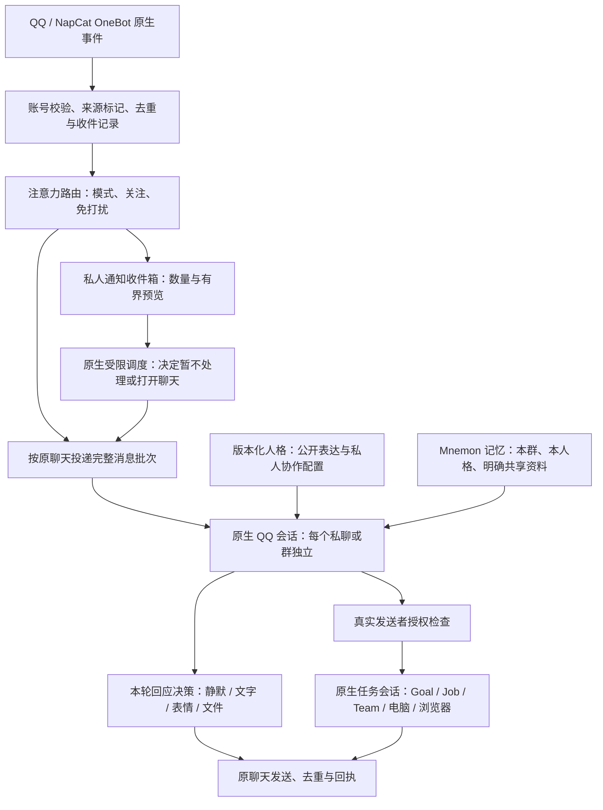

# 人格表达与 QQ 注意力

本页是下一版的目标规格；实际已发布能力仍以 [QQ 使用说明](../QQ.md) 和版本记录为准。人格定义表达与协作方式，注意力决定消息怎样进入上下文，权限决定能做什么。三者独立配置，共用原生 DSH 会话、事件、工具检查、Job、压缩与存储。

## 用户体验

人格页提供三个可编辑起点，不以固定人设替代用户配置：

| 起点     | 日常交流                                                     | 工作请求                                   |
| -------- | ------------------------------------------------------------ | ------------------------------------------ |
| 灵动交流 | 有情绪色彩、个性、幽默和自然回应，允许安静旁听；少用流程话术 | 主动完成获准工作，结论有依据，失败直接说明 |
| 严谨助手 | 克制、准确，不主动闲聊或模拟亲密关系                         | 严格遵循格式、步骤、验收和交付要求         |
| 自然协作 | 平时自然活泼，按关系与场景调整表达                           | 做事清楚可靠，需要时切换到简洁严谨的反馈   |

选择起点后，可以编辑公开的性格与语气、稳定原则、说话示例。选择自定义时不再套用起点的文字。私人协作要求和私人记忆单独保存，不因群聊采用同一人格而公开。人格模板仍有版本，已有会话采用新版本需明确操作；同一轮使用同一版本，换人格仍新建接续会话。

界面显示本会话实际使用的版本和配置，而非只显示最新模板。QQ 设置选择既有人格，显示公开表达预览；原“公开介绍”改为渠道补充说明，避免又维护一份人设。提示词中的技术规则只说明当前可用能力和必要边界，不要求每次回复汇报记忆查询或工具过程。

默认 Agent 预设下，公开人格表达通过原生系统提示词段提供，经历与事实继续通过记忆上下文提供；QQ 公共会话与群任务的完整提示词也从同一人格定义生成。高级用户自行选择“完整系统提示词”的自定义 Agent 预设时，沿用 DSH 的完整覆盖语义，需要在该预设内明确所需表达；PX 不偷偷改写这份高级配置。

长期记忆提供有来源的称呼、偏好、共同经历和纠正。记忆可以影响表达，但不能把他人一句话变成人格底线或执行授权。性格适应不等于自动改写人格模板。自然表达不应依赖虚构真实人类身份、线下生活或未发生的行动。

## 三种 QQ 模式

| 模式     | 完整消息上下文                                               | 其他消息                                                         | 对外行为                                                       |
| -------- | ------------------------------------------------------------ | ---------------------------------------------------------------- | -------------------------------------------------------------- |
| 专注聊天 | 账号实际收到的私聊和各群消息，按原聊天顺序分批处理           | 图片、表情、引用和文件保留消息段与可追溯引用，正文或媒体按需读取 | 模型选择旁听、文字、表情、表情包或任务转交，不要求每条回复     |
| 普通     | 私聊、真实 @、关注群的消息；直接询问前可读取同群未处理上下文 | 其他群合并为未读数量、发送时间和有限预览                         | 直接对话正常处理；关注群可自主参与，其他群按需打开             |
| 通知     | 本次不把完整聊天灌入正在工作的会话                           | 按免打扰及通知规则汇总私聊、@ 或允许通知的群消息                 | 先看到通知，再决定打开对应聊天；不直接把通知当作执行任务的命令 |

“关闭 QQ”是总开关，不是第四种人格。模式不改变账号、人格或任务权限。默认采用普通模式；用户可以固定模式，也可允许 Agent 在这些模式之间临时调整。Agent 可临时打开聊天、调整模式或群提醒，默认十分钟、最多三十分钟，到期或重启恢复。调整显示在界面，用户操作优先；不能借调整模式新增负责人、公开私有资料或扩大本机权限。

在仅通知模式中临时打开某个聊天，只展开这个聊天，不会顺带唤醒其他私聊或群内 @。整体切换模式是另一项明确操作。停止任务会取消停止前尚未处理的排队输入；新的消息仍能按当前模式处理，不需要永久关闭 QQ 才能停止一次工作。

每个聊天只需要“跟随模式 / 关注 / 免打扰”以及是否允许 @ 穿透免打扰等少量设置。默认关注名单为空，私聊与真实 @ 提醒开启。界面应显示实际来源：PX 设置、桥接同步或未知。OneBot 标准消息事件不保证包含官方 QQ 客户端的免打扰状态；未通过真实接口验证前，不声称已与 QQ 桌面端设置同步。

## 架构

### 消息与调度

- 收到、排队、进入模型上下文、决定旁听、发出回复和确认回执是不同状态，不能用“已收到”冒充已读或已回复。
- 专注模式覆盖实际接收到的各群消息，但按聊天隔离上下文。同一人格并不等于把所有群和私聊合并成一个可对外发言的上下文。
- 收件箱协调者可以看到授权范围内的通知预览，但只负责选择聊天，不直接给群写回复，也不能把跨群摘要转入目标群。目标会话从自身收件记录读取原文。
- 每个聊天保持顺序，不同聊天公平调度；合并短时间连续消息，不为每一条单独开一次模型请求。不把一个慢工具或群任务作为其他聊天必须等待的条件。
- 收件记录保存消息编号、发送者、原聊天、时间和消息段。队列有界，超出接纳容量的直接请求会收到限频提示；拥塞明确显示积压，不能静默截断后仍宣称全部读完。媒体不无限下载，保留引用并说明不可读状态。
- 通知不包含可执行权限；历史和旁听输入与当前直接请求分别标记。任务只能来自可信、当前、明确的授权成员请求，不能从预览、引用或混合聊天批次推导授权。
- 新模式不接管正在执行任务的原生运行循环。任务进展按原路交付，普通群消息不自动成为任务插话。负责人对具体任务的停止、审批和补充仍使用已有原生路由。

### 回应控制

旁听必须是明确的内部结果，不能发送“已读”“无需回复”等占位文字。文字、表情和文件可以组成一轮交付；发送表情后不自动补一条“我发了表情”。发送失败或结果未知时记录状态，不把同一个消息自动重复发出。重复事件、断线重连和重启不能重跑已完成的任务。

原生会话仍保存可检查的输入和输出。普通最终答案沿用原生文字交付；模型也可显式选择静默、发送文字或使用媒体工具。静默或媒体交付后，不再自动补发最终文字；需要额外说明时显式发送。分析说明、内部通知与静默结果不会转成 QQ 消息。不能为了要求模型填写额外协议而吞掉本来可交付的正常答案。

### 人格与权限

公开人格表达从同一个版本化定义生成，供 Desktop、私聊、公共群聊和群任务复用。私有协作指令仅进入对应私有上下文；群聊只使用公开表达和渠道补充说明。任务权限在代码中校验真实账号、发送者、当前回合和受众，不依赖模型是否听从提醒。

QQ ID 负责区分成员，昵称只作展示。群内长期偏好通过现有 Mnemon Documents 按人格与群分区保存；纠正、原文读取和证据沿用已有接口。注意力路由不新建一套人物档案库。不会因为性格更活泼而赋予新权限，也不会因为任务模式而删除原有记忆。

## 实现顺序与兼容

1. 增加可选的版本化公开表达配置、三个可编辑起点及统一提示词渲染；旧模板未配置时保持原语义，不能把已有私人指令自动公开。
2. 在 PX QQ 插件内实现收件与注意力状态。连接、账号与授权仍使用原生 configEditor，凭据仍使用 credentials；可即时切换的消息模式按账号保存在插件自己的存储中，修改不重启连接或打断任务。社区成员只做固定来源、可重建的投递和发送适配。
3. 接通按聊天的被动输入、显式静默与回应、通知收件箱和 Agent 调整入口；复用原生执行与调度，不增加外部机器人框架或独立模型服务。
4. 统一人格页、QQ 设置和运行状态，展示当前模式、关注、积压、最近调整及暂停入口，保持窄屏和键盘可用。
5. 完成隔离测试、真实模型与真实 QQ、Web 和 Electron 验收；候选精确提交独立审查、CI、构建、来源核验后发布，再更新本机。

预期以同兼容代际的 Pack 功能更新交付。若验证证明需要新的 Desktop/宿主接口、对现有聊天作不可逆迁移或新增外部服务，先单独确认范围；不能仅修改版本号来宣称兼容。

## 验收矩阵

| 范畴       | 方法                                                                       | 通过要求                                                                       |
| ---------- | -------------------------------------------------------------------------- | ------------------------------------------------------------------------------ |
| 三种人格   | 同模型、同输入、隔离会话分别配置；日常、安慰、纠错、严格格式、真实工作组合 | 仅改配置就能改变表达；严谨风格不擅自闲聊；灵动和兼顾风格仍完成工作且不虚构结果 |
| 人格一致性 | 首轮、同群 `/new`、私聊、群任务、重启与连续压缩                            | 使用可见的同一公开人格版本；私有部分不进入群；记忆纠正可找回                   |
| 静默与媒体 | 多人自然聊、真实 @、无需回复、仅表情、复用 GIF、长文件                     | 可读而不回复；不发静默占位；不在媒体后补无意义确认；交付可实际打开             |
| 三种模式   | 两个群加私聊，含关注、免打扰、@ 和 Agent 临时调整                          | 观察到的正文、预览、唤醒和发送与矩阵一致；用户关闭优先于 Agent 调整            |
| 任务并行   | 一个群执行慢任务，另一个群聊天，负责人中途停止或追加要求                   | 聊天不串行等任务；停止生效；普通消息不污染任务请求或审批                       |
| 来源与隐私 | 昵称冒认、引用伪造、跨群内容请求、混合成员消息和历史授权重放               | 不获得执行权限；不带出其他聊天、私人指令和记忆；正常授权任务仍可用             |
| 可靠性     | 重复事件、重连、重启、队列拥塞、失败和发送结果未知                         | 不重做任务或重复发送；未处理数据可见，恢复状态真实                             |
| 展示与发布 | Web/Electron 分别操作，隔离安装与本机更新后复核                            | 页面可用、状态和配置一致、来源与包相符、使用说明足以复现                       |

风格验收保留输入、实际答案、所用配置和模型版本，按自然度、人格一致性、格式遵循、任务正确性及越权/泄漏分别评估；不能只用关键词匹配或模型自评分冒充完成。真实 QQ 测试只向明确授权的测试聊天发送内容。未验证的消息类型、容量和自动同步能力应在发布说明中列明。

## 已核对的原生依据

- DSH 与插件固定版本及职责见 [插件合约](../PLUGINS.md)，不依赖未安装的上游新功能。
- [NapCat API](https://napneko.github.io/onebot/api) 提供历史、成员和发送接口；具体 QQ 登录状态及接口返回需在当前桥接上验证。
- [NapCat 事件定义](https://napneko.github.io/onebot/event) 提供账号、会话、发送者、消息编号和消息段；收到哪些事件不等于模型已经读取其内容。
